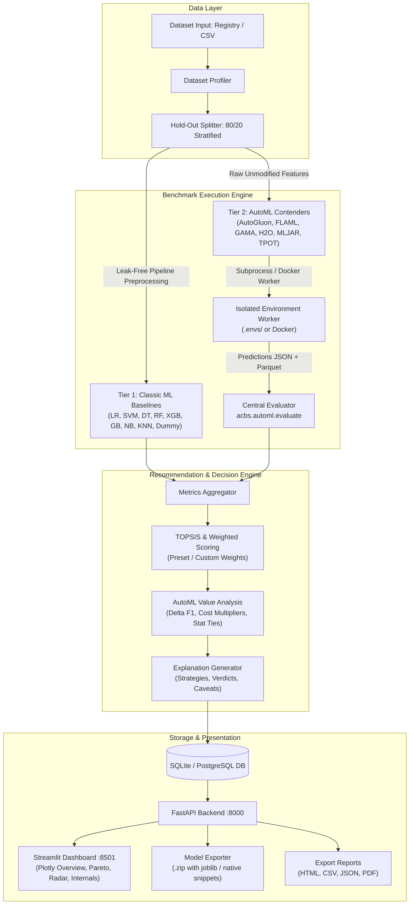

# acbs v2: System Architecture

The **Auto Classifier Benchmarking System (acbs)** evaluates classic machine learning classifiers and automated machine learning (AutoML) frameworks under a fair, leak-free, reproducible experimental protocol.

---

## 1. Two-Tier Benchmarking Architecture



---

## 2. Worker Contract (`TrainSpec` & `RunResult`)

All AutoML frameworks are isolated from the main application to eliminate dependency collisions (e.g. pinned versions of NumPy, PyTorch, or scikit-learn). Communication occurs through JSON-serializable contracts over `stdin`/`stdout`:

- **Input (`TrainSpec`)**:
  - `framework_id`: Unique identifier (e.g., `flaml`, `autogluon`).
  - `train_path`, `test_path`: Parquet files containing raw features and target.
  - `target_column`: Name of target column.
  - `time_budget_s`: Wall-clock training limit in seconds.
  - `n_jobs`, `seed`, `metric`: Hardware and optimization criteria.

- **Output (`RunResult`)**:
  - `status`: `ok`, `failed`, `timeout`, `unavailable`, `unsupported`.
  - `fit_time_s`, `predict_time_per_1k_s`: Precision timing.
  - `budget_used_ratio`: Fraction of budget consumed ($0.0 - 1.0$).
  - `peak_mem_mb`: Peak resident set size (RSS).
  - `predictions_path`: Output parquet containing `y_pred` and ordered probability columns `y_proba`.
  - `model_summary`, `leaderboard`: Framework-native inspection details.

---

## 3. How to Add a New AutoML Framework

Adding a new contender requires only two steps:

1. **Register in `envs/frameworks.yaml`**:
   ```yaml
   my_automl:
     name: "MyAutoML"
     pip:
       - "my-automl-pkg==1.2.0"
     strategy: "Evolutionary pipeline synthesis"
     os_supported: ["Linux", "Windows", "Darwin"]
   ```

2. **Implement Worker in `src/acbs/automl/workers/my_automl_worker.py`**:
   ```python
   from acbs.automl.contracts import RunResult, TrainSpec
   # 1. Read TrainSpec from sys.stdin
   # 2. Fit framework on spec.train_path with spec.time_budget_s
   # 3. Predict probas and save to spec.output_dir / "predictions.parquet"
   # 4. Output RunResult.to_json() to sys.stdout
   ```

Run `python scripts/setup_envs.py` to create its dedicated virtual environment under `.envs/my_automl/`.

---

## 4. Execution Backends

The runner supports two backends (`backend` parameter in `runner.run_framework`):
- `venv`: Calls `.envs/<framework>/Scripts/python.exe` (Windows) or `bin/python` (Linux).
- `docker`: Dispatches to `acbs-fw-<id>:latest` Docker container via `docker run --rm -i`.
